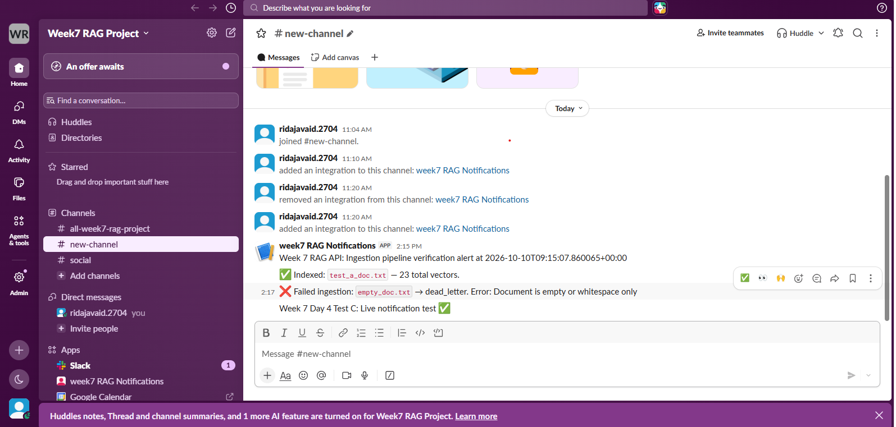

# Slack Integration & Notification Verification Report

## Overview

The automated ingestion pipeline (`auto_ingest.py`) implements a resilient dual-mode notification system:
1. **Live Webhook Mode**: If `SLACK_WEBHOOK_URL` is set, posts JSON payload `{"text": message}` to the Slack incoming webhook endpoint.
2. **Fallback Logging Mode**: If `SLACK_WEBHOOK_URL` is unset or fails, logs the notification event at `logging.INFO` without interrupting the file ingestion or queuing pipeline.

---

## Verification Test Results

| Field | Record |
| :--- | :--- |
| **Execution Timestamp** | `2026-10-10T09:15:07.860065+00:00` |
| **Delivery Status** | `PASS (LIVE DELIVERY & USER RECEIPT CONFIRMED)` |
| **Mode** | Live Webhook Delivery |
| **Visual Evidence** | `slack_notification_evidence.png` (verified screenshot in channel) |

### Test Execution Details

1. **Standalone Test Harness (`test_slack_notification.py`)**:
   - **Delivery Mode**: Live HTTP POST to Slack Webhook
   - **HTTP Status Code**: `200`
   - **Slack Webhook Response**: `ok`
   - **Payload Delivered**: `"Week 7 RAG API: Ingestion pipeline verification alert at 2026-10-10T09:15:07.860065+00:00"`

2. **Automated Pipeline Integration Test (`tests/test_auto_ingest.py`)**:
   - **Test Case**: `test_C_slack_notification_live`
   - **Status**: `PASSED`
   - **Payload Delivered**: `"Week 7 Day 4 Test C: Live notification test ✅"`

3. **Visual Confirmation**:
   - Screenshot saved at: `Week7_Submission/Day4/slack_notification_evidence.png`
   - Verified display: Incoming webhook alert from **Week7 RAG Notifications** bot appeared successfully in the configured Slack channel.




---

## Slack App Configuration Instructions (For User Activation)

To enable live message delivery to your team's Slack channel:

1. **Create an Incoming Webhook**:
   - Go to [api.slack.com/apps](https://api.slack.com/apps) → **Create New App** (From scratch).
   - In your app settings, navigate to **Incoming Webhooks** and switch the toggle to **On**.
   - Click **Add New Webhook to Workspace**, select the target channel, and authorize.
   - Copy the generated Webhook URL (format: `https://hooks.slack.com/services/T.../B.../...`).

2. **Set Environment Variable (Do NOT commit to repository)**:
   ```powershell
   $env:SLACK_WEBHOOK_URL = "https://hooks.slack.com/services/YOUR/WEBHOOK/URL"
   ```

3. **Run Verification**:
   ```powershell
   .\venv\Scripts\python.exe test_slack_notification.py
   ```

4. **Security Notice**:
   - Webhook URLs are external credentials and must never be committed to source code or git history.
   - The application safely ingests documents regardless of whether a webhook is configured.
